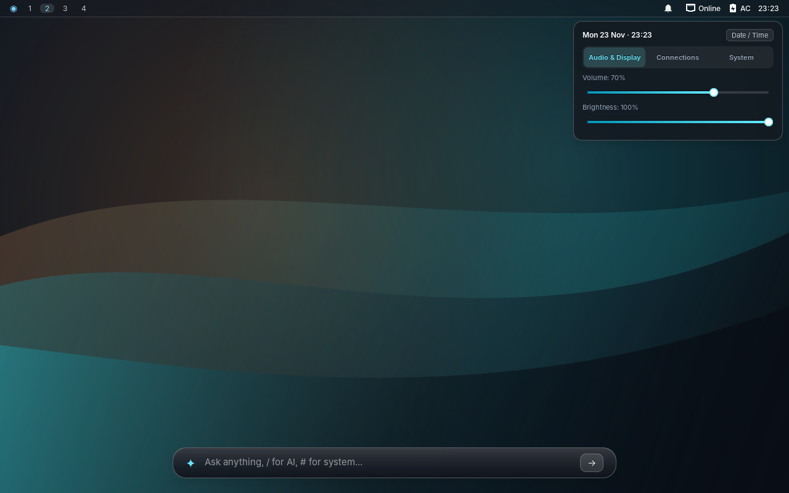
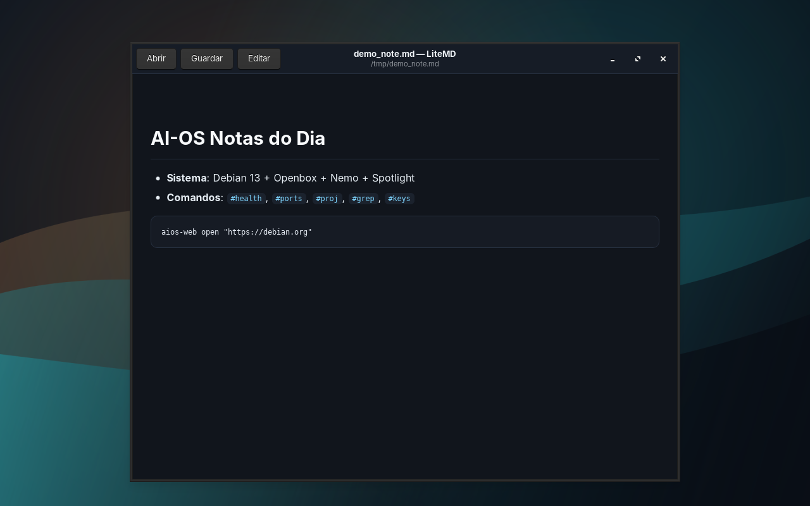

# AI-OS Debian

> **An AI-first minimalist desktop operating system built on Debian 13 (Trixie) Netinst** — zero bloat, a distraction-free Openbox + Nemo desktop, and a native GTK3/WebKit2 **Spotlight Command Bar** powered by an autonomous AI agent under the hood.

[](https://www.debian.org/)
[](http://openbox.org/)
[](https://gtk.org/)
[](https://fastapi.tiangolo.com/)


[Português (PT-PT)](#-versão-em-português) | [English](#-english-version)

---

## 🇵🇹 Versão em Português

### Visão Geral
O **AI-OS Debian** substitui o ambiente de trabalho tradicional cheio de menus por uma experiência focada em **velocidade, automação e linguagem natural**:
- **Sem bloat**: Debian 13 Netinst com `APT::Install-Recommends "false"`, `01_nodoc`, `zram-tools` (LZ4), `earlyoom` e ~380–400 MB de RAM em idle.
- **Spotlight AI Nativo (`Super+Espaço`)**: barra flutuante sempre acessível para abrir apps, pesquisar ficheiros em profundidade, correr comandos de sistema (`#`) e conversar em streaming com o assistente AI (`/` ou texto livre) — abstraindo o motor de agente por baixo.
- **Barra Superior Minimalista (`AITopBar`)**: workspaces (`1–4`), janelas abertas com fecho rápido (`×`), centro de **Notificações & Automações (`DND` + `crontab`)**, e **Painel de Controlo** (Volume, Brilho, Wi-Fi, Bluetooth, Ecrãs, Fuso Horário, Energia) com abertura ao passar o rato.

---

### Galeria do Sistema

| Ambiente de Trabalho & Spotlight | Saúde do SO (`#health`) |
| :---: | :---: |
|  |  |

| Painel de Controlo (Hover) | Sino: Notificações & Automações |
| :---: | :---: |
|  |  |

| Definições AI-OS (`#settings`) | LiteMD (Leitor & Editor Markdown) |
| :---: | :---: |
|  |  |

---

### Funcionalidades Principais

- **Spotlight Multimodal & Streaming**
  - **Chat sem bordas pesadas**: respostas em largura total, botão `Copiar` por resposta e por bloco de código, links externos abrem no Chromium, `A-`/`A+` (8–18px) sincronizados ao vivo com as Definições, botão `Novo chat` e `Abrir no LiteMD`.
  - **Anexos fáceis**: autocomplete `@ficheiros` (BFS recursivo), **Drag & Drop** de ficheiros do ambiente de trabalho (`Gdk.DragAction.COPY`) e **`Ctrl+V`** de imagens do clipboard.
  - **Guardrail de Segurança**: pedidos destrutivos (`rm -rf`, formatação, remoção de pacotes, `reboot`/`poweroff`) exigem confirmação explícita na UI e na API (`/api/ask`, `/api/ask_stream`).
- **Automações Nativas (`crontab`) & Lembretes (`Zero Polling`)**
  - Lembretes únicos (`#remind 10m pausa`) via `threading.Timer` em memória.
  - Automações recorrentes criadas em linguagem natural no chat (*"todos os dias às 09:00 verifica X"*) via `crontab` nativo (`/api/crons` + `run_cron.sh`), com **Pausar/Retomar (`#PAUSED`)**, tradução legível (`Todos os dias às 09:00`) e notificações fixas até fechar (`dunst`).
- **Produtividade Diária (`#`)**
  - `#health` — Estado de `server.py`, `nemo-desktop`, `dunst`, `picom`, `cron`, disco e RAM.
  - `#ports` — Lista portas TCP abertas e containers **Podman** com paragem rápida.
  - `#proj` — Lista repositórios em `~/Projetos` (com branch Git) e abre Terminal lá dentro.
  - `#grep <termo>` — Pesquisa texto dentro de `~/Documentos`, `~/Desktop` e `~/Projetos`.
  - `#clip` — Histórico de clipboard com **Snippets fixados (`[Pin]`)**.
  - `#keys` — Folha rápida de atalhos do sistema.
  - `#displays` — Seletor gráfico de resolução `xrandr`.
  - `#audit` / `#notif` / `#settings` / `#update`.
- **LiteMD (`litemd.py`)**
  - Leitor e editor Markdown/Texto predefinido (`text/markdown`, `text/plain`) com alternância `Editar`/`Ver` (`Ctrl+E`) e gravação (`Ctrl+S`).
- **Browser Agent (`aios-web`)**
  - Automação real do Chromium via CDP (`127.0.0.1:9222`): `open`, `dom`, `wait`, `fill`, `click`, `press`, `scroll`, `tabs`, `screenshot`.

---

### Atalhos de Teclado

| Atalho | Ação |
|---|---|
| `Super+Espaço` / `Alt+Espaço` | Focar Spotlight |
| `Super+T` | Abrir Terminal (`xterm`) |
| `Super+L` | Bloquear ecrã (`i3lock`) |
| `Super+1..4` | Mudar de Workspace |
| `Super+Shift+1..4` | Mover janela para Workspace |
| `Super+← / → / ↑ / ↓` | Encaixar / Maximizar janela |
| `Alt+Arrastar` / `Alt+F4` | Mover / Fechar qualquer janela |
| `Print` / `Super+Shift+S` | Captura de ecrã anexada ao Spotlight |
| `Ctrl+H` / `Ctrl+V` | Histórico de chats / Colar imagem |

---

### Arquitetura & Ficheiros

```text
├── build-iso.sh             # Gera ISO Debian bootável (live-build / preseed)
├── preseed.cfg              # Instalação autónoma Debian Netinst
├── install-aios.sh          # Provisionamento completo do sistema
├── AGENTS.md                # Constituição e ferramentas do agente AI
├── config/
│   ├── openbox/             # autostart, rc.xml (keybinds & margins), themerc
│   ├── dunstrc              # Notificações persistentes (timeout=0 critical)
│   ├── picom.conf           # Compositor XRender leve
│   ├── litemd.desktop       # Associação MIME para Markdown & Texto
│   ├── aios-cdp             # Flags Chromium CDP (127.0.0.1:9222)
│   └── 01_nodoc, 99norecommends
├── spotlight/
│   ├── spotlight_ui.py      # TopBar, Popovers, Settings, Spotlight GTK3+WebKit2
│   ├── server.py            # API FastAPI (127.0.0.1:8765), streaming, crons, ports
│   ├── i18n.py              # Localização PT-PT/EN, guardrails & human_cron()
│   ├── litemd.py            # Leitor & Editor Markdown GTK3+WebKit2
│   ├── web_agent.py         # CLI aios-web via Chromium CDP
│   ├── wallpaper.py         # Wallpaper dinâmico Cairo + feh + gsettings
│   ├── gestures.py          # Gestos touchpad (libinput)
│   ├── run_cron.sh          # Executor base64 de automações crontab
│   ├── lock.sh, screenshot.sh, update.sh
└── tests/
    └── test_smoke.py        # Testes automáticos (py_compile, bash -n, XML, i18n)
```

---

### Instalação & Testes

```bash
# Provisionar numa máquina Debian 12/13 limpa:
git clone https://github.com/casousavng/aios-debian.git
cd aios-debian && bash install-aios.sh

# Correr suite de validação local:
python3 -m unittest discover -s tests -v
```

---

## 🇬🇧 English Version

### Overview
**AI-OS Debian** replaces heavy desktop environments with a fast, distraction-free workspace centered around a native GTK3/WebKit2 **Spotlight Command Bar** and an autonomous AI backend:

- **Lean Footprint**: Debian 13 Netinst with `APT::Install-Recommends "false"`, `zram-tools`, `earlyoom`, `Openbox`, `Nemo` desktop icons, and `picom` (~400 MB idle RAM).
- **Native Spotlight (`Super+Space`)**: Launch apps, search files recursively, run system tools (`#`), and stream AI tasks seamlessly.
- **Hover TopBar (`AITopBar`)**: Workspaces (`1–4`), open windows switcher with quick close (`×`), **Notifications & Automations Bell** (`DND` mode + `crontab` schedules), and **Control Center** (Volume, Brightness, Wi-Fi, Bluetooth, Displays, Timezone, Power).
- **Built-in Productivity**: `#health`, `#ports` (TCP + Podman), `#proj` (`~/Projetos`), `#grep`, `#clip` (pinned snippets), `#keys`, `#displays`, and **LiteMD** (`litemd.py`) as the default Markdown & text editor.

### Quick Start & Testing

```bash
git clone https://github.com/casousavng/aios-debian.git
cd aios-debian && bash install-aios.sh

# Run smoke tests:
python3 -m unittest discover -s tests -v
```
