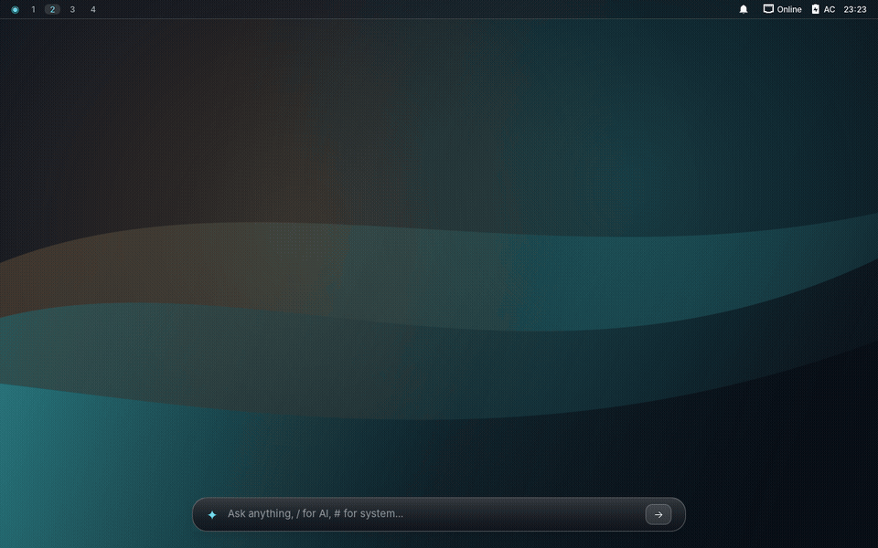
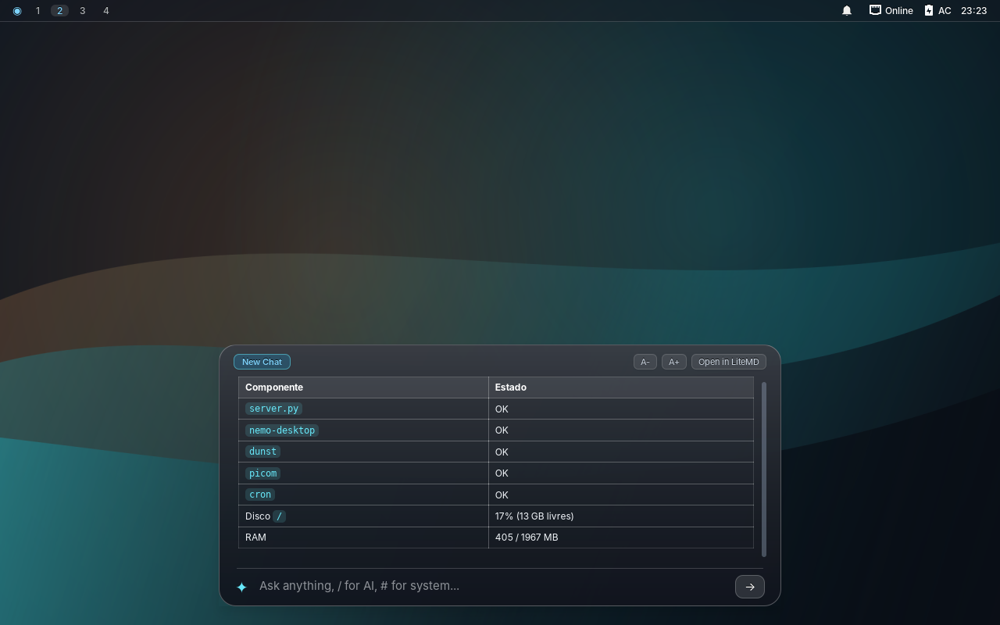
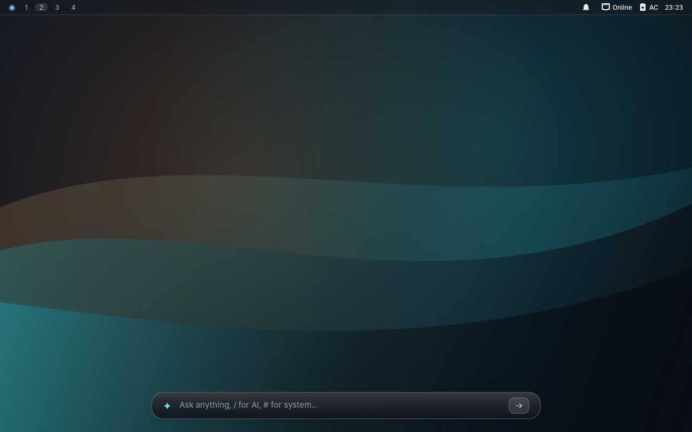

# AI-OS Debian

> **Um sistema operativo desktop AI-first construído de raiz sobre Debian 13 (Trixie) Netinst** — concebido para eliminar ruído visual, menus redundantes e sobrecarga de recursos, colocando um **Spotlight nativo** e um **agente autónomo abstraído** no centro de toda a operação diária.

[](https://www.debian.org/)
[](http://openbox.org/)
[](https://gtk.org/)
[](https://fastapi.tiangolo.com/)
[](https://podman.io/)



[Português (PT-PT)](#-versão-em-português) | [English](#-english-version)

---

## 🇵🇹 Versão em Português

### 1. Filosofia & Decisões de Arquitetura (O Quê e Porquê)

Cada componente deste sistema foi escolhido para maximizar **agilidade, previsibilidade e baixo consumo** (~380–400 MB RAM em idle):

| Camada | Escolha | Porquê esta decisão |
|---|---|---|
| **Base do SO** | **Debian 13 Netinst** + `APT::Install-Recommends "false"` + `01_nodoc` | Controlo cirúrgico do que entra no disco: zero pacotes supérfluos, zero documentação/manpages pesadas, arranque direto em `tty1` para sessão gráfica. |
| **Memória & Estabilidade** | `zram-tools` (LZ4) + `earlyoom` + `journald` limitado (`50M`) | Mantém o sistema responsivo em VMs e portáteis com pouca RAM, evitando congelamentos por OOM ou crescimento silencioso de logs. |
| **Gestor de Janelas** | **Openbox** + `picom` (XRender) + `_NET_WM_STRUT_PARTIAL` | Ultraleve, configurável por XML (`rc.xml`), com tiling por teclado, resistência de bordas para proteger a barra superior e transparências suaves sem depender de aceleração 3D. |
| **Ambiente de Trabalho** | **Nemo** (`nemo-desktop`) + `feh` + `Papirus-Dark` | Ícones reais no Desktop com posicionamento livre (`gvfsd-metadata`) e drag-and-drop fluido para dentro do Spotlight; `feh` pinta a root window X11 com o wallpaper dinâmico Cairo. |
| **Interface Principal** | **GTK3 + WebKit2GTK** (`spotlight_ui.py`) | Em vez de Electron ou separadores de browser, uma janela nativa ancorada em baixo (`720px`), transparente, com streaming Markdown em WebKit2 e zero latência de arranque. |
| **Motor AI Abstraído** | **FastAPI** (`127.0.0.1:8765`) + Wrapper de Agente CLI | O utilizador interage apenas com o **AI-OS** (perfis *Rápido / Profundo / Só Planear*, login Google, streaming, guardrails). O motor CLI fica encapsulado por baixo, permitindo evoluir modelos sem mudar a experiência. |
| **Automações & Lembretes** | **`crontab` nativo** + `threading.Timer` (**Zero Polling**) | Em vez de loops Python a ler o disco de X em X segundos, os lembretes únicos usam timers em memória e as recorrências usam o `cron` do próprio Linux — consumo de CPU praticamente nulo em repouso. |
| **Leitor & Editor de Docs** | **LiteMD** (`litemd.py`) | Um único utilitário leve (`GTK3 + WebKit2`) registado como predefinido para Markdown e texto plano, alternando instantaneamente entre leitura estilizada e edição (`Ctrl+E` / `Ctrl+S`). |
| **Browser & Automação Web** | **Chromium** com CDP (`127.0.0.1:9222`) + `aios-web` | Permite ao assistente abrir páginas, ler DOM (incluindo `iframes` e Shadow DOM), preencher formulários e tirar screenshots diretamente no browser real do utilizador. |
| **Isolamento de Ferramentas** | **Podman Rootless** + `ufw` + `i3lock` | Serviços e servidores MCP correm isolados sem sujar o sistema anfitrião; firewall e bloqueio instantâneo vêm ativos de raiz. |

---

### 2. Galeria do Sistema

| Ambiente de Trabalho & Spotlight | Saúde do SO (`#health`) |
| :---: | :---: |
|  |  |

| Painel de Controlo (Hover) | Sino: Notificações & Automações |
| :---: | :---: |
|  |  |

| Definições AI-OS (`#settings`) | LiteMD (Leitor & Editor Markdown) |
| :---: | :---: |
|  |  |

---

### 3. Guia Completo de Funcionalidades

#### Spotlight & Chat AI
- **Lançador Universal**: pesquisa simultânea de aplicações instaladas, ações rápidas do sistema, projetos em `~/Projetos` e ficheiros em profundidade (`~/Desktop`, `~/Documentos`, `~/Projetos`, `~/Downloads`).
- **Chat em Streaming**:
  - Respostas renderizadas a 100% de largura (sem bordas aninhadas), indicador vivo pulsante durante execução de ferramentas e botão `■` para interromper a qualquer momento.
  - Botão `Copiar` por resposta e por bloco de código; links externos abrem diretamente no **Chromium** e `.md` locais abrem no **LiteMD**.
  - Barra de controlo rápido: **`Novo chat`** (feedback temporário de 2,5s no placeholder), **`A-` / `A+`** (8–18px sincronizado ao vivo com as Definições) e **`Abrir no LiteMD`**.
  - Recolhe automaticamente ao clicar fora ou com `Escape`, preservando a conversa no botão `▲` para retomar depois (`Ctrl+H` lista histórico de conversas).
- **Anexos Multimodais**:
  - **`@ficheiros`**: autocomplete recursivo ao escrever `@`.
  - **Drag & Drop**: arrastar ficheiros do Desktop ou Nemo para a barra anexa-os como `@caminho` sem mover os originais.
  - **`Ctrl+V` de Imagem / `Print`**: cola screenshots diretamente no pedido para análise visual.
- **Guardrail de Segurança**: pedidos destrutivos (`rm -rf`, formatação de disco, remoção de pacotes, `reboot`/`poweroff`, alterações críticas de permissões/serviços) exigem confirmação explícita via modal seguro (foco padrão em *Cancelar*) e bloqueio na API.

#### Barra Superior (`AITopBar`) & Popovers por Hover
- **Workspaces (`1–4`) & Janelas Abertas**: alternância por clique, atalho ou scroll do rato; menu esquerdo **AI-OS** lista janelas por workspace com foco rápido e botão **`×`** para fechar diretamente.
- **Sino (Notificações & Automações)**:
  - Mostra na barra apenas a contagem de **notificações** registadas.
  - Popover com duas abas: **Notificações** (histórico + botão **`DND`** ligado ao `dunstctl` + *Limpar*) e **Automações** (lembretes e crons em linguagem legível como `Todos os dias às 09:00`, com **Pausar/Retomar** e **Remover**).
- **Painel de Controlo (Hardware & Sistema)**:
  - **Som & Ecrã**: sliders de volume (`wpctl`) e brilho (`brightnessctl`/`xrandr`), mais seleção de saída de áudio.
  - **Ligações**: redes Wi-Fi (`nmcli`) e Bluetooth (`bluetoothctl`).
  - **Sistema**: gestor de resoluções `xrandr`, bloqueio (`i3lock`), reiniciar, desligar e estado Podman/teclado, além de ajuste de **Data/Hora & Timezone**.

#### Automações (`cron`) & Lembretes
- **Por Comando (`#remind`)**: `#remind 10m Pausa` (aceita `s`, `m`, `h`) ou `#reminders` / `#crons` para listar e gerir.
- **Por Linguagem Natural no Chat**: basta pedir *"todos os dias às 09:00 verifica X"* ou *"daqui a 3 minutos abre o site Y e cria um resumo no Desktop"*. O sistema cria a entrada no `crontab` (`run_cron.sh`), mantém o chat principal limpo (auto-reset de sessão efémera) e entrega notificações persistentes até o utilizador as fechar.

#### Comandos Rápidos do Sistema (`#`) e Assistente (`/`)

| Comando | Função |
|---|---|
| `#health` | Estado ao vivo de `server.py`, `nemo-desktop`, `dunst`, `picom`, `cron`, disco `/` e RAM |
| `#ports` | Lista portas TCP em escuta e containers **Podman** com opção de paragem segura |
| `#proj` | Lista projetos em `~/Projetos` (com branch Git) e abre Terminal dentro da pasta |
| `#grep <termo>` | Pesquisa texto dentro de ficheiros em `~/Documentos`, `~/Desktop` e `~/Projetos` |
| `#clip` | Histórico de clipboard com **Snippets fixados (`[Pin]`)** |
| `#keys` | Folha rápida de todos os atalhos de teclado e rato |
| `#displays` | Seletor gráfico de resolução e monitores (`xrandr`) |
| `#settings` | Janela centrada de Definições (Perfis AI, Sessão/Consumo, Fonte, Idioma, Teclado, Sistema) |
| `#audit` / `#notif` | Registo de auditoria de ações da IA e histórico de notificações |
| `#apps` / `#chats` | Lista completa de apps instaladas / Conversas guardadas (`Ctrl+H`) |
| `#lang` / `#kb` / `#tz` | Alternar idioma (`pt`/`en`), teclado (`pt`/`us`/`es`/`fr`/`gb`) ou fuso horário |
| `#update` / `#lock` | Atualização com validação + rollback atómico (`update.sh`) / Bloqueio (`i3lock`) |
| `/model`, `/mode`, `/usage` | Seleção de modelo, modo (`auto`, `accept-edits`, `plan`) e consumo |

#### Atalhos de Teclado & Rato

| Atalho | Ação |
|---|---|
| `Super+Espaço` / `Alt+Espaço` | Focar Spotlight |
| `Super+T` | Abrir Terminal (`xterm`) |
| `Super+L` | Bloquear ecrã (`i3lock`) |
| `Super+1..4` | Mudar de Workspace |
| `Super+Shift+1..4` | Mover janela ativa para Workspace e acompanhar |
| `Super+← / → / ↑ / ↓` | Encaixar à esquerda/direita ou maximizar janela |
| `Alt+Arrastar` / `Alt+F4` | Mover ou fechar qualquer janela |
| `Print` / `Super+Shift+S` | Captura de ecrã anexada ao Spotlight |
| `Ctrl+H` / `Ctrl+V` | Histórico de chats / Colar imagem no pedido |
| `XF86Audio*` / `XF86MonBrightness*` | Volume e brilho com OSD persistente (`dunst`) |

---

### 4. Estrutura, Instalação & Build ISO

```text
├── build-iso.sh             # Gera ISO Debian bootável (live-build / preseed)
├── preseed.cfg              # Instalação autónoma Debian Netinst
├── install-aios.sh          # Provisionamento completo do sistema
├── AGENTS.md                # Constituição, regras e ferramentas do agente
├── config/
│   ├── openbox/             # autostart, rc.xml, themerc
│   ├── dunstrc              # Notificações persistentes (timeout=0 critical)
│   ├── picom.conf           # Compositor XRender leve
│   ├── litemd.desktop       # Associação MIME para Markdown & Texto
│   ├── aios-cdp             # Flags Chromium CDP (127.0.0.1:9222)
│   └── 01_nodoc, 99norecommends
├── spotlight/
│   ├── spotlight_ui.py      # TopBar, Popovers, Settings, Spotlight GTK3+WebKit2
│   ├── server.py            # Backend FastAPI (127.0.0.1:8765), streaming, crons, ports
│   ├── i18n.py              # Localização PT-PT/EN, guardrails & human_cron()
│   ├── litemd.py            # Leitor & Editor Markdown/Texto GTK3+WebKit2
│   ├── web_agent.py         # CLI aios-web via Chromium CDP
│   ├── wallpaper.py         # Wallpaper dinâmico Cairo + feh + gsettings
│   ├── gestures.py          # Gestos touchpad (libinput)
│   ├── run_cron.sh          # Executor de automações crontab
│   └── lock.sh, screenshot.sh, update.sh
└── tests/
    └── test_smoke.py        # Suite unittest (compilação, shell, XML, i18n, guardrails, cron)
```

```bash
# Provisionar numa máquina Debian 12/13 limpa:
git clone https://github.com/casousavng/aios-debian.git
cd aios-debian && bash install-aios.sh

# Validar suite de testes:
python3 -m unittest discover -s tests -v
```

---

## 🇬🇧 English Version

### Philosophy & Why These Choices
**AI-OS Debian** is built from the ground up on **Debian 13 Netinst** to keep idle memory around **380–400 MB** while placing a native **GTK3 + WebKit2 Spotlight** and an abstracted AI assistant at the center of daily workflows:

- **Minimal Base**: `APT::Install-Recommends "false"`, `01_nodoc`, `zram-tools` (LZ4), `earlyoom`, and `50M` capped `journald`.
- **Window & Desktop Layer**: **Openbox** (`_NET_WM_STRUT_PARTIAL`, edge resistance, tiling & workspace keybinds), `picom` (XRender), `Nemo` desktop icons with free positioning, and `feh` + Cairo dynamic wallpapers.
- **Native Spotlight (`Super+Space`)**: Borderless streaming replies, per-message and per-code-block copy, external link routing to Chromium, live font scaling (`8–18px`), `@file` recursive search, `Gdk.DragAction.COPY` file drops, `Ctrl+V` image paste, and explicit confirmation guardrails for destructive prompts.
- **Zero-Polling Schedules**: One-shot reminders run on in-memory `threading.Timer`; recurring and natural-language automations run on native Linux **`crontab`** (`run_cron.sh`) with pause/resume (`#PAUSED`), human-readable labels, and sticky `dunst` notifications.
- **Daily Dev Tools**: `#health`, `#ports` (TCP + Podman), `#proj` (`~/Projetos`), `#grep`, `#clip` pinned snippets, `#keys`, `#displays`, **LiteMD** (`Ctrl+E` edit / `Ctrl+S` save), and **`aios-web`** Chromium CDP browser automation.

```bash
git clone https://github.com/casousavng/aios-debian.git
cd aios-debian && bash install-aios.sh
python3 -m unittest discover -s tests -v
```
